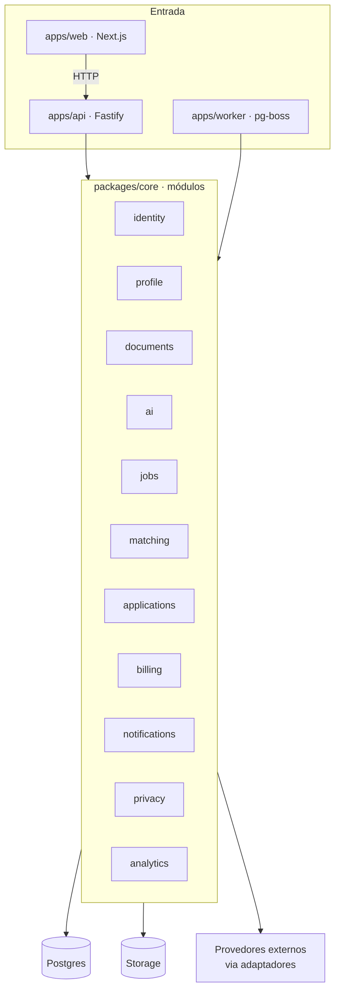

# 02 — Arquitetura geral

## 4. Visão geral

Monólito modular, com arquitetura hexagonal (portas e adaptadores) dentro de cada módulo. O domínio não conhece banco, framework HTTP nem provedores externos: ele declara **portas** (interfaces), e a camada de infraestrutura fornece os **adaptadores**.



## 5. Separação de responsabilidades

| Parte | Responsabilidade | Não faz |
|---|---|---|
| **Frontend** (`apps/web`) | Telas, estado de UI, chamadas à API, acessibilidade, i18n | Regra de negócio, acesso direto ao banco, chamadas à IA |
| **API** (`apps/api`) | Autenticação, autorização, validação de entrada, execução de casos de uso síncronos, enfileiramento de tarefas | Trabalho pesado ou demorado (IA, PDF, envio de candidaturas) |
| **Workers** (`apps/worker`) | Extração de documentos, chamadas de IA, matching, sincronização de fontes, envio de candidaturas, expurgo, exportação de dados | Responder a requisições HTTP |
| **Banco** (Postgres) | Dados de domínio, perfil estruturado (`jsonb`), embeddings (pgvector), fila (pg-boss), outbox de eventos, auditoria | Guardar arquivos binários |
| **Storage de objetos** | PDFs, DOCX, currículos gerados, exportações de dados | Ser acessado publicamente. Acesso só por URL assinada e temporária. |
| **Integrações** | Adaptadores de IA, fontes de vagas, pagamento, e-mail e OAuth | Conter regra de negócio |

### Módulos

Cada módulo é um contexto delimitado, com API pública própria (`index.ts`). Um módulo só importa o que outro módulo exporta nessa API; acessar arquivos internos de outro módulo quebra o build (regra do dependency-cruiser).

| Módulo | Responsabilidade |
|---|---|
| `identity` | Usuários, sessões, identidades OAuth, papéis |
| `profile` | Perfil profissional, fatos verificados, objetivos de carreira, links, score do perfil |
| `documents` | Upload, armazenamento, extração de texto, retenção de arquivos |
| `ai` | Porta `AiProvider`, registro de prompts versionados, validação anti-invenção, log de gerações |
| `jobs` | Vagas normalizadas, adaptadores de fontes, importação manual |
| `matching` | Score de compatibilidade, ranking personalizado, feedback e preferências aprendidas |
| `applications` | Máquina de estados da candidatura, material, aprovação, envio, pendências manuais |
| `billing` | Planos, entitlements, assinaturas, registro de consumo e quotas |
| `notifications` | E-mail e notificações no app |
| `privacy` | Consentimentos, exclusão, exportação, políticas de retenção |
| `analytics` | Eventos de produto e métricas |
| `shared` (kernel) | Tipos comuns: `Result`, erros, IDs, relógio, paginação |

### Comunicação entre módulos

- **Síncrona:** um caso de uso chama a API pública de outro módulo. Exemplo: `applications` consulta `billing.checkQuota()`.
- **Assíncrona:** eventos de domínio gravados numa tabela **outbox** na mesma transação da mudança, e publicados na fila pelo worker. Isso garante que nenhum evento se perca quando a transação dá certo, e que nenhum evento saia quando ela falha.

## 12. Multi-tenancy

O produto é B2C: o **tenant é o usuário**.

- Um único banco, com esquema compartilhado. Toda tabela com dados de usuário tem `user_id`.
- **Duas camadas de isolamento:**
  1. **Aplicação:** todo repositório recebe o `userId` da sessão e filtra por ele. Não existe método de repositório "sem dono".
  2. **Banco:** Row Level Security nas tabelas de dados pessoais. A API define `app.current_user_id` na transação, e as políticas de RLS comparam com essa variável. Se a aplicação errar um filtro, o banco bloqueia.
- Testes automatizados tentam ler dados de outro usuário em cada endpoint e esperam falha.
- **Futuro B2B** (recrutadores, bootcamps, empresas): adicionar `account_id` acima de `user_id`. A estrutura de RLS já suporta essa extensão.
- **Usuários internacionais:** campo `data_region` no usuário, reservado para uma futura separação de dados por região, se algum mercado exigir.

## 17. Estrutura de pastas recomendada

```text
linkediner/
├── apps/
│   ├── web/                       # Next.js: só UI
│   │   └── src/{app,components,features,lib/api-client,i18n}
│   ├── api/                       # Fastify: rotas, auth, composição
│   │   └── src/{routes,plugins,composition-root.ts,server.ts}
│   └── worker/                    # pg-boss: handlers de tarefas
│       └── src/{handlers,schedules,composition-root.ts,main.ts}
├── packages/
│   ├── core/                      # domínio e casos de uso, por módulo
│   │   └── src/modules/
│   │       ├── profile/
│   │       │   ├── domain/        # entidades, value objects, regras (TS puro)
│   │       │   ├── application/   # casos de uso, portas (interfaces)
│   │       │   ├── infrastructure/# adaptadores: repositórios Drizzle etc.
│   │       │   └── index.ts       # API pública do módulo
│   │       ├── ai/
│   │       │   ├── application/ports/ai-provider.ts
│   │       │   ├── infrastructure/providers/gemini/
│   │       │   ├── infrastructure/providers/fake/   # para testes
│   │       │   └── prompts/       # prompts versionados (v1, v2...)
│   │       ├── jobs/
│   │       │   └── infrastructure/sources/{manual,greenhouse,lever,company-site}/
│   │       ├── documents/ matching/ applications/ billing/
│   │       ├── identity/ notifications/ privacy/ analytics/
│   │       └── shared/            # kernel compartilhado
│   ├── db/                        # schema Drizzle, migrações, políticas RLS, seeds
│   ├── contracts/                 # esquemas Zod da API e dos eventos, OpenAPI
│   ├── config/                    # leitura e validação das variáveis de ambiente
│   ├── observability/             # logger com redação, tracing, métricas
│   ├── ui/                        # tokens e componentes do design system
│   └── tooling/                   # configs de ESLint, TS, Vitest
├── tests/
│   ├── e2e/                       # Playwright
│   └── ai-evals/                  # conjunto de avaliação da IA
├── infra/
│   ├── docker/                    # Dockerfiles
│   └── compose.yaml               # ambiente local
├── docs/
│   ├── arquitetura/
│   └── adr/
└── .github/workflows/             # CI
```

Os itens da estrutura pedida no prompt foram mapeados assim:

| Item pedido | Onde fica |
|---|---|
| Domínio | `packages/core/src/modules/*/domain` |
| Casos de uso | `packages/core/src/modules/*/application` |
| Integrações | `packages/core/src/modules/*/infrastructure` (adaptadores) |
| Persistência | `packages/db` + repositórios em `infrastructure` |
| Serviços de IA | `modules/ai` |
| Processamento de documentos | `modules/documents` |
| Autenticação | `modules/identity` + plugin de auth em `apps/api` |
| Billing e planos | `modules/billing` |
| Notificações | `modules/notifications` |
| Candidaturas | `modules/applications` |
| Recomendação de vagas | `modules/matching` |
| Observabilidade | `packages/observability` |
| Configuração | `packages/config` |
| Testes | `*.test.ts` junto do código + `tests/` |
