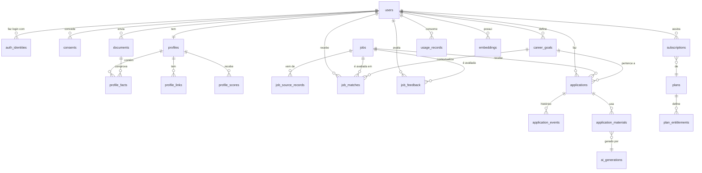

# 03 — Modelo de dados

Banco: PostgreSQL com pgvector ([ADR 0001](../adr/0001-banco-de-dados.md)). Convenções: IDs `uuid` v7 (ordenáveis por tempo), `created_at`/`updated_at` em UTC, `user_id` em toda tabela de dados pessoais, RLS habilitado nessas tabelas.

## 15. Principais entidades e relacionamentos

## 14. Tabelas iniciais

### Identidade e privacidade

| Tabela | Campos principais | Observações |
|---|---|---|
| `users` | id, email, name, locale, timezone, data_region, status (`active`, `pending_deletion`, `deleted`), created_at | `name` e `email` nunca vão para logs |
| `auth_identities` | id, user_id, provider (`google`, `github`, `linkedin`, `password`), provider_subject, scopes, created_at | Tokens OAuth, quando necessários, ficam criptografados e com escopo mínimo. Nunca guardamos senha de conta externa. |
| `sessions` | id, user_id, expires_at, ip_hash, user_agent | Gerenciada pela biblioteca de auth |
| `consents` | id, user_id, purpose (`terms`, `privacy`, `ai_processing`, `auto_apply`, `marketing`, `model_training`), version, granted, granted_at, revoked_at | Cada concessão ou revogação gera uma nova linha. `model_training` nasce `false` e exige ação explícita e separada. |
| `deletion_requests` | id, user_id, requested_at, status, completed_at, report | Rastreia o expurgo em todos os sistemas |
| `data_exports` | id, user_id, status, object_key, expires_at | Arquivo de exportação expira em 7 dias |
| `audit_logs` | id, actor_type, actor_id, action, entity_type, entity_id, metadata (sem PII), ip_hash, created_at | Somente inserção. `actor_id` é pseudonimizado após a exclusão do usuário. |

### Perfil e documentos

| Tabela | Campos principais | Observações |
|---|---|---|
| `career_goals` | id, user_id, title, seniority, target_roles[], locations[], remote_only, salary_min, currency, is_active | Vários objetivos por usuário. Exemplo: "Frontend sênior remoto Brasil" e "Full stack exterior". |
| `documents` | id, user_id, kind (`resume`, `linkedin_pdf`, `generated_resume`, `cover_letter`), object_key, mime, size, sha256, status, failure_code, expires_at | O texto extraído não é guardado ([ADR 0012](../adr/0012-extracao-so-com-texto-verificavel.md)). `expires_at` = criação + 30 dias. |
| `profiles` | id, user_id, headline, summary, years_experience, current_version | Um por usuário |
| `profile_facts` | id, profile_id, type (`experience`, `skill`, `project`, `education`, `certification`, `language`, `achievement`), data (jsonb), source_document_id, source_span, verification (`extracted`, `user_confirmed`, `suggested`, `rejected`) | **Base da regra anti-invenção:** todo conteúdo gerado precisa apontar para fatos `extracted` ou `user_confirmed`. |
| `profile_links` | id, profile_id, kind (`linkedin`, `github`, `portfolio`, `other`), url, last_checked_at | |
| `profile_scores` | id, profile_id, score (0–100), rubric_version, factors (jsonb: positivos, lacunas, recomendações), created_at | Histórico para medir a evolução do score |

### Vagas e matching

| Tabela | Campos principais | Observações |
|---|---|---|
| `job_sources` | id, key (`manual`, `greenhouse`, `lever`, `company_site`, ...), capabilities (jsonb), status, terms_reviewed_at | Liga ou desliga uma fonte sem deploy |
| `jobs` | id, title, company_name, company_domain, description, requirements (jsonb), seniority, employment_type, location, remote_policy, salary_min, salary_max, currency, apply_url, posted_at, status, dedupe_hash | Vaga normalizada, independente de fonte |
| `job_source_records` | id, job_id, source_id, external_id, raw (jsonb), fetched_at, imported_by_user_id | Rastreabilidade da origem. `imported_by_user_id` existe quando a importação foi manual. |
| `job_matches` | id, user_id, job_id, career_goal_id, score, rubric_version, factors (jsonb), rank_score, created_at | O score de compatibilidade é explicável. O `rank_score` incorpora as preferências aprendidas. |
| `job_feedback` | id, user_id, job_id, reason (`liked`, `disliked`, `too_senior`, `misaligned`, `salary_mismatch`, `location_mismatch`, `tech_mismatch`, `company_blocked`, `already_applied`, `more_like_this`), note, created_at | |
| `user_preferences` | user_id, weights (jsonb), blocked_companies[], preferred_stacks[], updated_at | Pesos por usuário, atualizados a partir do feedback |
| `embeddings` | id, user_id (nulo para vagas), entity_type (`profile`, `job`, `goal`), entity_id, model, dims, vector (`vector(768)`), created_at | Índice HNSW. Os embeddings de um usuário são apagados junto com ele. |

### Candidaturas

| Tabela | Campos principais | Observações |
|---|---|---|
| `applications` | id, user_id, job_id, career_goal_id, state, submission_mode (`api`, `assisted`, `manual`), source_id, submitted_at, external_reference, last_error_code | Estados em [04 — Fluxos](04-fluxos.md) |
| `application_events` | id, application_id, from_state, to_state, actor (`user`, `system`, `source`), reason, created_at | Histórico imutável |
| `application_materials` | id, application_id, kind (`resume`, `cover_letter`, `form_answers`), content (jsonb), document_id, ai_generation_id, status (`draft`, `approved`, `rejected`), approved_at | Só material `approved` pode ser exportado ou enviado |
| `manual_tasks` | id, application_id, reason (`no_integration`, `blocked_by_source`, `captcha`, `extra_fields`), instructions (jsonb), due_at, resolved_at | Pendências de preenchimento manual |

### IA

| Tabela | Campos principais | Observações |
|---|---|---|
| `ai_generations` | id, user_id, task (`extract_profile`, `score_profile`, `match_job`, `generate_resume`, `cover_letter`, `form_answers`, `classify_job`), provider, model, prompt_id, prompt_version, input_hash, output (jsonb, criptografado), validation (jsonb: fatos citados, alegações sem fonte), tokens_in, tokens_out, cost_usd, latency_ms, created_at | Rastreabilidade exigida pelo prompt do produto |

### Planos e consumo

| Tabela | Campos principais | Observações |
|---|---|---|
| `plans` | id, key (`free`, `pro`, `advanced`), name, active, version | Preço fica no provedor de pagamento |
| `plan_entitlements` | plan_id, feature_key, limit_value, period (`month`, `day`, `lifetime`) | Exemplos: `applications.auto` = 0, 30 ou 100 por mês; `export.watermark` = true ou false |
| `subscriptions` | id, user_id, plan_id, status, provider, provider_subscription_id, current_period_start, current_period_end | |
| `usage_records` | id, user_id, feature_key, quantity, period_key, idempotency_key, created_at | Ledger somente de inserção. O saldo do período é a soma. |

### Infraestrutura

| Tabela | Campos principais | Observações |
|---|---|---|
| `outbox_events` | id, type, payload (jsonb, sem PII em claro), occurred_at, published_at | Publicação garantida de eventos |
| `product_events` | id, user_ref (pseudônimo), name, properties (jsonb), dedupe_key, occurred_at | Base das métricas ([09](09-planos-quotas-metricas.md)). Retenção de 13 meses |
| `pgboss.*` | — | Esquema da fila, gerenciado pelo pg-boss |

## Retenção por tipo de dado

| Dado | Retenção padrão | Na exclusão da conta |
|---|---|---|
| Arquivos enviados (PDF, DOCX) | 30 dias (regra de ciclo de vida do storage + job diário) | Apagados imediatamente |
| Texto extraído | Não é guardado. O trecho que comprova cada fato é apagado junto com o documento. | Apagado |
| Fatos do perfil e score | Enquanto a conta existir | Apagados |
| Embeddings | Enquanto a conta existir | Apagados |
| Gerações de IA | 90 dias (configurável) | Apagadas |
| Candidaturas e histórico | Enquanto a conta existir | Apagados |
| Logs de aplicação | 30 dias, sem PII | Nada a apagar |
| Auditoria | 5 anos, pseudonimizada | Mantida pseudonimizada, para obrigação legal |
| Eventos de produto | 13 meses, pseudonimizados | Mantidos sem ligação com a pessoa: o pseudônimo vira um valor aleatório |
| Backups | 7–30 dias | Conteúdo de carreira ilegível por crypto-shredding. O restante expira com o backup ([ADR 0020](../adr/0020-criptografia-por-usuario.md)) |
| Chaves por usuário | Enquanto a conta existir, em bucket próprio fora dos backups do banco | Destruídas |
