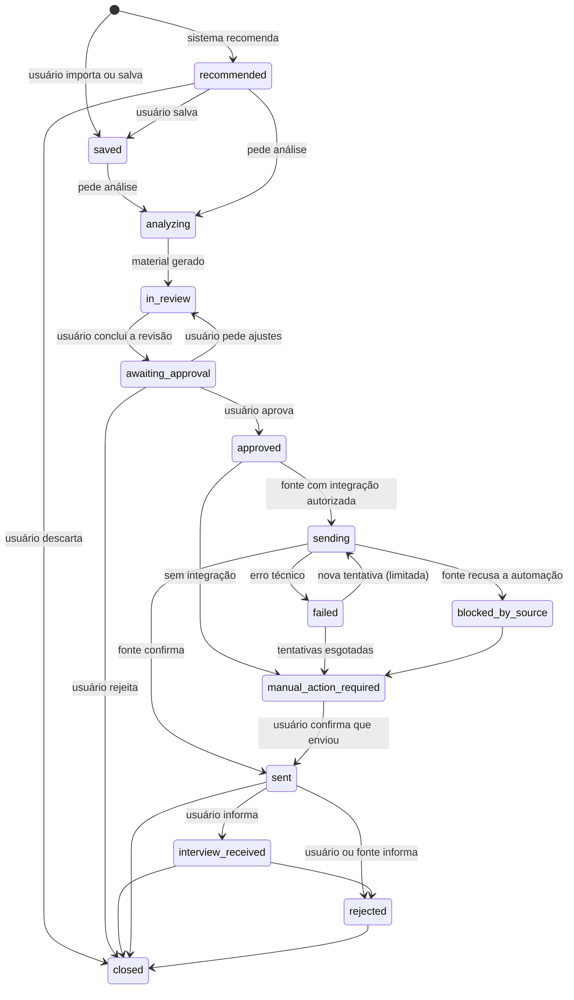
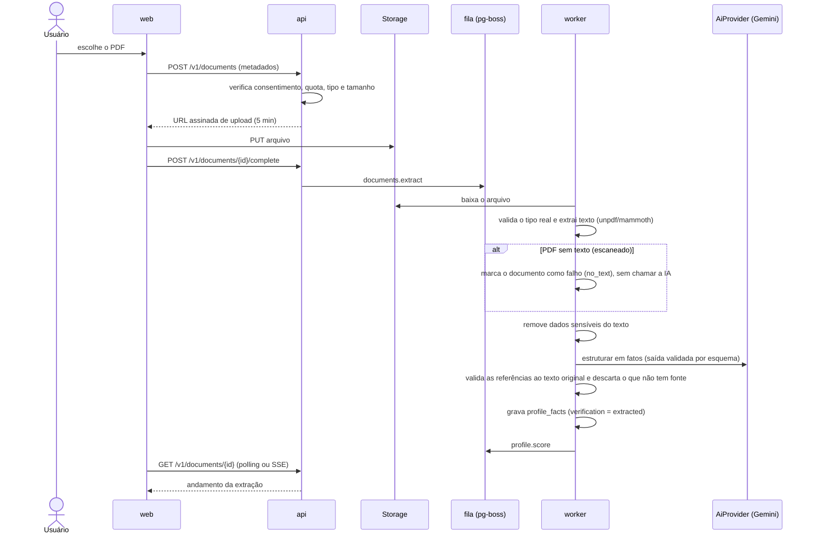
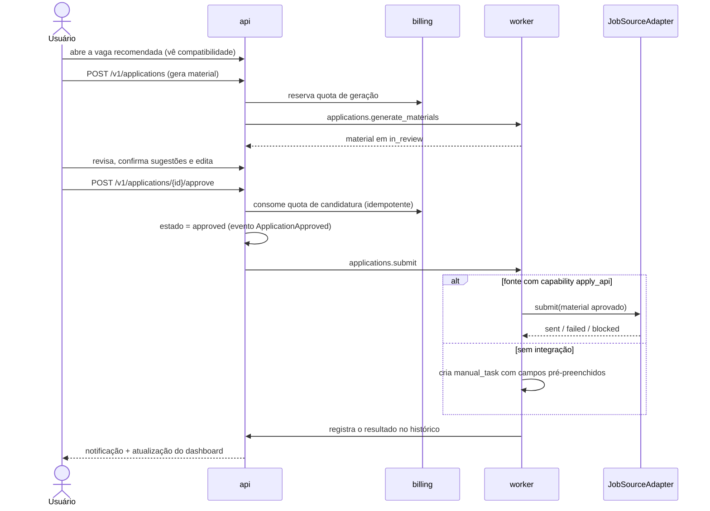

# 04 — Fluxos críticos

## Máquina de estados da candidatura

As transições são validadas no domínio (`modules/applications/domain/application-state.ts`). Cada transição grava um registro em `application_events`. Nenhum caminho leva a `sending` sem passar por `approved`, e `approved` só pode ser alcançado por ação do usuário.

| Estado (código) | Nome na interface | Cor do badge |
|---|---|---|
| `recommended` | Recomendada | Accent |
| `saved` | Salva | Accent |
| `analyzing` | Em análise | Accent |
| `in_review` | Em revisão | Warning |
| `awaiting_approval` | Aguardando aprovação | Warning |
| `approved` | Aprovada | Success |
| `sending` | Enviando | Info |
| `sent` | Enviada | Success |
| `failed` | Falhou | Danger |
| `blocked_by_source` | Bloqueada pela fonte | Danger |
| `manual_action_required` | Requer ação manual | Warning |
| `interview_received` | Entrevista recebida | Info |
| `rejected` | Rejeitada | Danger |
| `closed` | Encerrada | Neutral |

## 16. Fluxos do usuário

### F1 — Cadastro e consentimentos

1. O usuário entra com Google, GitHub, LinkedIn (OIDC) ou e-mail e senha.
2. Aceita os termos e a política de privacidade. Esse consentimento é obrigatório e versionado.
3. Escolhe o consentimento opcional de processamento por IA, necessário para análise. Fica explícito que os dados não serão usados para treinar modelos.
4. Cria o primeiro objetivo de carreira.

### F2 — Upload e extração do currículo

### F3 — Score do perfil

1. O worker reúne os fatos do perfil.
2. O motor de rubrica (determinístico e versionado) calcula o score de 0 a 100 a partir de critérios objetivos: completude, métricas nas experiências, clareza, links verificáveis, aderência ao objetivo.
3. Os textos explicativos e as recomendações vêm de modelos fixos em código, sem chamar a IA ([ADR 0013](../adr/0013-score-v1-sem-ia.md)).
4. Grava em `profile_scores` com `rubric_version`. A interface mostra os fatores positivos, as lacunas e as recomendações, com o aviso de que o score não indica chance de contratação.

### F4 — Currículo melhorado e aprovação

1. O usuário pede um currículo melhorado (sem vaga) ou personalizado (com vaga).
2. A IA gera o currículo a partir dos fatos `extracted` e `user_confirmed`.
3. O validador anti-invenção compara cada alegação com os fatos. Alegação sem fonte vira item `suggested`, que aparece em destaque como "Precisa da sua confirmação".
4. O usuário confirma (o fato vira `user_confirmed`), edita ou remove cada sugestão.
5. O usuário aprova. Só então a exportação fica liberada. No plano gratuito, a exportação sai com marca d'água.

### F5 — Importação de vaga e score de compatibilidade

1. O usuário cola o texto ou o link da vaga, ou ela chega por uma fonte autorizada.
2. A IA estrutura os requisitos. A vaga é deduplicada por `dedupe_hash`.
3. O matching calcula o score de compatibilidade por regras ([ADR 0016](../adr/0016-compatibilidade-v1-por-regras.md)), com fatores explicáveis: o que combina e quais são as lacunas. Os embeddings entram numa versão futura.
4. O `rank_score` aplica as preferências aprendidas para ordenar as recomendações.

### F6 — Candidatura (o fluxo central)

**O que existe hoje:** o material é o currículo geral aprovado ou o currículo adaptado à vaga, além da carta e das respostas de formulário (ADR 0018). Tudo é conferido contra os fatos e fica congelado a partir da aprovação. Como ainda não há fonte autorizada, toda aprovação vira pendência manual, e o envio automático (`sending`) só existe na máquina de estados. Candidatura enviada tira a vaga das recomendações.

**Regras invariantes do fluxo:**
- O worker de envio recusa qualquer candidatura sem um evento `ApplicationApproved` do próprio usuário, verificado de novo antes do envio.
- O material enviado é exatamente a versão aprovada. Qualquer edição posterior volta o estado para `in_review`.
- O envio é idempotente: usa uma chave por candidatura para não enviar duas vezes a mesma vaga.

### F7 — Feedback da vaga

1. O usuário escolhe um motivo (Gostei, Muito sênior, Salário incompatível...).
2. Grava em `job_feedback`. As preferências são calculadas a partir das avaliações, na hora da consulta ([ADR 0017](../adr/0017-preferencias-derivadas-do-feedback.md)).
3. O ajuste no MVP é simples e explicável:
   - `company_blocked` adiciona a empresa a `blocked_companies`;
   - `too_senior` reduz o peso de vagas acima da senioridade do objetivo;
   - `tech_mismatch` reduz o peso das tecnologias da vaga;
   - `more_like_this` aumenta a similaridade com os embeddings da vaga.
4. A explicação da recomendação mostra o motivo. Exemplo: "Recomendada porque combina com React e TypeScript e você pediu mais vagas como a da Nubank."

### F8 — Exclusão de dados

1. O usuário pede a exclusão. A conta vai para `pending_deletion` e a sessão é encerrada.
2. O job `privacy.purge_user` apaga, em ordem:
   1. cancela tarefas pendentes na fila;
   2. apaga arquivos no storage;
   3. apaga linhas de banco em cascata (perfil, fatos, embeddings, gerações, candidaturas, feedback);
   4. destrói a chave do usuário (crypto-shredding);
   5. cancela a assinatura no provedor de pagamento;
   6. pseudonimiza a auditoria.
3. O job gera um relatório em `deletion_requests` e envia a confirmação por e-mail.
4. Prazo: imediato para dados ativos. Nos backups, o conteúdo de carreira fica ilegível porque a chave foi destruída, e o restante expira com o backup (ADR 0020).

**O que existe hoje:** o expurgo, com o cancelamento da assinatura, a destruição da chave, a pseudonimização e o relatório (ADR 0019, 0020 e 0021). O e-mail de confirmação ainda não existe.

### F9 — Exportação de dados

O usuário pede a exportação. O worker gera um ZIP com JSON e arquivos, guardado por 7 dias. A cada consulta, a API devolve uma URL assinada, válida por 5 minutos (ADR 0019).
