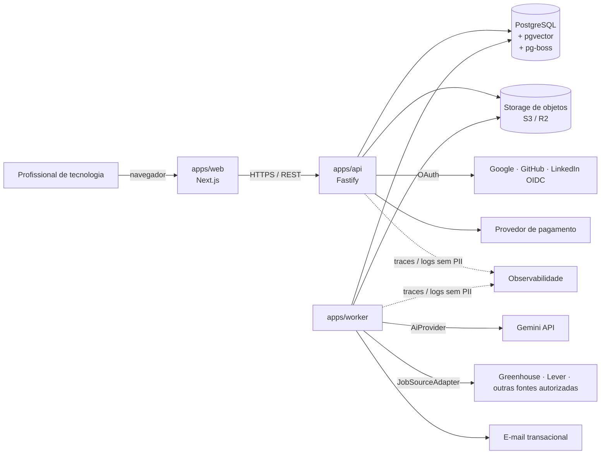

# Arquitetura do LinkedIner

Versão 0.1 — proposta inicial, aguardando aprovação antes da Fase 3 (fundação do projeto).

## Índice

| # | Documento | Itens do escopo cobertos |
|---|---|---|
| 00 | [Descoberta técnica](00-descoberta.md) | Fase 1: estado do repositório, restrições, dúvidas bloqueadoras |
| 01 | [Stack](01-stack.md) | 2. Comparação de linguagens e frameworks · 3. Recomendação final |
| 02 | [Arquitetura geral](02-arquitetura-geral.md) | 4. Arquitetura · 5. Separação de camadas · 12. Multi-tenancy · 17. Estrutura de pastas |
| 03 | [Dados](03-dados.md) | 14. Modelo de dados · 15. Entidades e relacionamentos |
| 04 | [Fluxos críticos](04-fluxos.md) | 16. Fluxos do usuário · máquina de estados da candidatura |
| 05 | [IA e documentos](05-ia-e-documentos.md) | 7. Processamento de PDFs · 8. Integração com IA |
| 06 | [Fontes de vagas e candidaturas](06-fontes-e-candidaturas.md) | Adaptadores por fonte · automação autorizada · candidatura assistida |
| 07 | [Segurança e privacidade](07-seguranca-e-privacidade.md) | 6. Autenticação e autorização · 11. Segurança e privacidade |
| 08 | [Operação](08-operacao.md) | 9. Filas · 10. Observabilidade · 19. Testes · 20. Deploy |
| 09 | [Planos, quotas e métricas](09-planos-quotas-metricas.md) | 13. Quotas e planos · métricas do produto |
| 10 | [Contratos](10-contratos.md) | 18. API REST e eventos |
| 11 | [Riscos, backlog e roadmap](11-riscos-backlog-roadmap.md) | 21. Riscos e decisões adiadas · 23. Backlog do MVP · 24. Roadmap |
| — | [ADRs](../adr/README.md) | 22. Registro de decisões |

## 1. Resumo executivo

**O que é:** um SaaS B2C que analisa o perfil profissional de quem trabalha com tecnologia, recomenda vagas compatíveis, gera material de candidatura personalizado e acompanha cada candidatura, sempre com aprovação do usuário antes de qualquer envio.

**Arquitetura recomendada:** um **monólito modular em TypeScript**, com três pontos de entrada que compartilham o mesmo código de domínio:

- `apps/web`: frontend em Next.js. Apenas interface; não contém regra de negócio.
- `apps/api`: API HTTP em Fastify, que expõe os casos de uso.
- `apps/worker`: processos assíncronos (extração de PDF, chamadas de IA, matching, envio de candidaturas, expurgo de dados).

**Dados:** PostgreSQL com pgvector guarda os dados relacionais, o perfil estruturado (`jsonb`) e os embeddings. Arquivos ficam num storage de objetos compatível com S3, com expiração automática em 30 dias. A fila também roda no Postgres (pg-boss), o que adia a necessidade de Redis.

**IA:** o domínio depende de uma interface (`AiProvider`), e o Gemini é a primeira implementação. Toda geração importante grava provedor, modelo, versão do prompt e resultado. O **score não é calculado pela IA**: a IA extrai fatos e o score vem de regras determinísticas e versionadas, o que o torna explicável e auditável.

**Integrações:** cada fonte de vagas é um adaptador independente que declara suas capacidades (listar vagas, candidatar via API, apenas candidatura assistida). LinkedIn e Indeed entram, de início, por **importação manual** feita pelo usuário. Não há scraping.

**Por que não microserviços:** time pequeno, domínio ainda em descoberta e volume baixo no MVP. O monólito modular dá fronteiras claras entre os módulos (com verificação automática de dependências) sem o custo operacional de vários serviços. Os módulos de maior carga (worker de IA, envio de candidaturas) já nascem separados como processos, e podem virar serviços no futuro se houver justificativa.

## Diagrama de contexto

## Premissas assumidas

Cada premissa abaixo é uma decisão razoável tomada para não travar o trabalho. Elas estão documentadas aqui para revisão, e cada uma pode ser revista.

1. TypeScript é a linguagem do projeto, por decisão do time.
2. O time é pequeno (1 a 3 pessoas) e generalista.
3. O público inicial é brasileiro, mas o produto precisa estar pronto para usuários de outros países. Interface em pt-BR primeiro, com i18n preparado.
4. Hospedagem em nuvem gerenciada, com região em São Paulo quando houver.
5. O plano gratuito do Gemini serve só para protótipo com dados sintéticos (ver [ADR 0004](../adr/0004-provedor-de-ia.md)).
